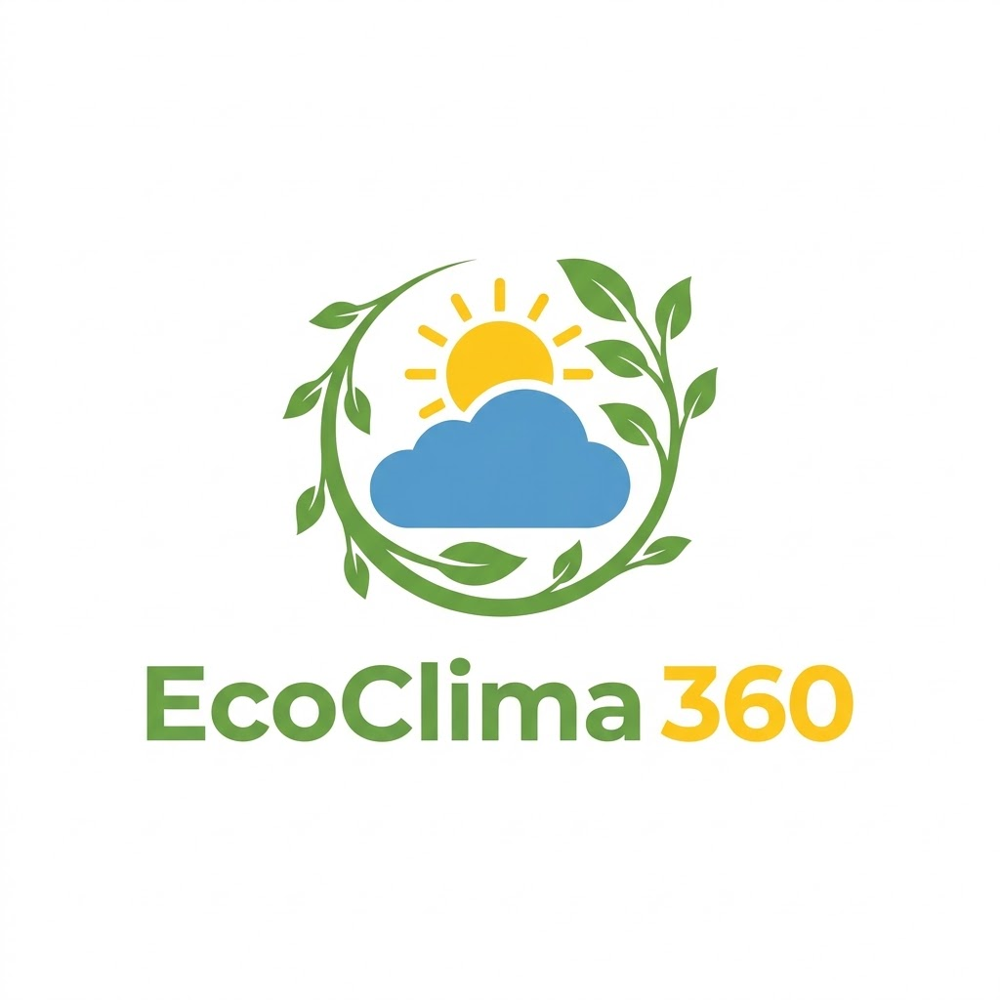

# EcoClima 360 - Aplicación Web de Análisis Meteorológico

## Descripción General
**EcoClima 360** es una plataforma web interactiva desarrollada en **Streamlit** para la visualización, exploración y análisis lúdico de registros meteorológicos y climáticos. La aplicación permite a los usuarios consultar datos históricos de temperatura, humedad y precipitaciones, descubrir patrones mediante visualizaciones dinámicas y participar en un juego interactivo de predicción climática.

---

## 👥 Equipo de Trabajo

### Evelis Gabriela Jiménez Estrada

Soy estudiante de Ingeniería Industrial de la Universidad de Antioquia. Me interesa aprender sobre nuevas herramientas y poner en práctica mis conocimientos en proyectos que me permitan fortalecer mis habilidades. Me gusta trabajar en equipo, aportar ideas y asumir nuevos retos. En este proyecto estoy encargada de coordinar las actividades del equipo y administrar el repositorio de GitHub, apoyando la organización y el seguimiento del trabajo.

---

### Jhonatan Alexis Urán Serna

Soy estudiante de Ingeniería Industrial en la Universidad de Antioquia. Me considero una persona alegre, inteligente, espontánea y con facilidad para aprender. Me caracterizo por ser responsable, detallista y comprometido con mis actividades. Tengo habilidades para el trabajo en equipo, la comunicación y el manejo de herramientas ofimáticas como Word, Excel y PowerPoint. Siempre busco dar lo mejor de mí, aprender cosas nuevas y crecer personal y profesionalmente. En el proyecto me encargo del desarrollo de la aplicación y la arquitectura interactiva.

---

### Brayan Ardany Pérez Cardona

Tengo 31 años y soy estudiante de Ingeniería Industrial en la Universidad de Antioquia. Cuento con sólidas habilidades en herramientas ofimáticas y actualmente me desempeño como auxiliar comercial de proyectos en una empresa de iluminación, experiencia que me ha permitido desarrollar organización, análisis y orientación a resultados. En **EcoClima 360** estoy dispuesto a aportar de manera integral en todos los ámbitos del equipo, asumiendo como función principal la gestión, limpieza y validación de los datos.

---

### Yeison Enrique López Mosquera

Tengo 28 años y soy estudiante de Ingeniería Industrial de la Universidad de Antioquia. Cuento con conocimientos y habilidades en Excel, Python y gestión logística, enfocado en la optimización de procesos y el análisis estructurado de la información. Dentro del proyecto desempeño el rol de **investigador de aplicación, documentación técnica y pruebas**, asegurando la calidad y claridad funcional de la herramienta.

---

## Reporte de Visión
Proporcionar a estudiantes, investigadores y ciudadanos una herramienta accesible e intuitiva para visualizar y comprender las variables climatológicas (temperatura, precipitación y humedad) registradas por el IDEAM en los diferentes departamentos de Colombia.
* **Objetivo:** Facilitar el acceso y la comprensión de datos climáticos mediante herramientas interactivas de análisis y dinámicas de gamificación.
* **Beneficios:** Promover la educación ambiental y el análisis de datos de manera accesible e intuitiva para usuarios no expertos y estudiantes.

---

## Licencia y Créditos
Este proyecto está bajo la licencia **Creative Commons Attribution-NonCommercial 4.0 International (CC BY-NC 4.0)**. Consultar el archivo `docs/LICENSE.md` para más detalles.